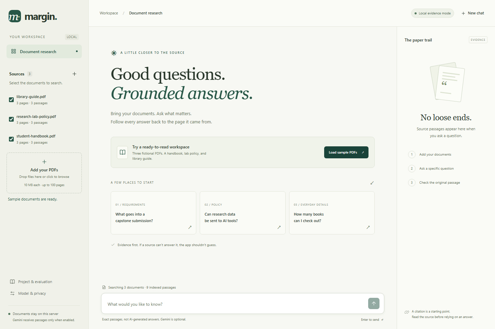

# Margin

### A little closer to the source.

A PDF question-answering workspace built for the **RAG Chatbot over Documents** project in the supplied assignment screenshot.

Upload PDFs, choose which ones to search, and inspect the page behind each citation. Embeddings and retrieval run on the Python backend. Add a Gemini API key with usable quota for generated answers, or use the clearly labeled evidence mode without credentials.



## Live demo and ownership handoff

**https://margin-rag.vercel.app** hosts both the frontend and Python/FastAPI backend on Vercel Hobby. Private Vercel Blob storage persists workspace PDFs and vectors across function restarts. Gemini is now enabled with a working server-side key. The latest development evaluation passed all 24 question checks: 18 supported answers and 6 abstentions. The public app also passed live generated-answer and citation checks.

See [docs/DEPLOYMENT.md](docs/DEPLOYMENT.md) for free-tier limits, the hosted verification results, and how to hand the project and storage to your friend. No paid plan or billing change was enabled.

## Start on Windows

Requires **Python 3.12** and [uv](https://docs.astral.sh/uv/getting-started/installation/). No Node.js build is needed.

```powershell
cd C:\RAG-Chatbot
uv sync --frozen
uv run uvicorn app.main:app --host 127.0.0.1 --port 8000
```

Open **http://127.0.0.1:8000**. You can also run `start.cmd` or `./start.ps1` from the project directory. Both install the locked dependencies and start the server on localhost.

On macOS or Linux, use the same `uv sync` and `uv run` commands from your checkout directory.

Click **Load sample PDFs** to try the included fictional documents. The first indexing request downloads the BGE embedding model: about 67 MB of weights, plus tokenizer files. How long that takes depends on your connection. Once the model is cached, indexing and local retrieval work offline.

## Enable Gemini generation

The assignment asks for generated answers. **Local evidence mode alone does not complete that requirement.**

1. Create a Gemini API key in [Google AI Studio](https://aistudio.google.com/apikey).
2. Copy `.env.example` to `.env`.
3. Set `GEMINI_API_KEY` in `.env`. The default generation model is `gemini-3.5-flash-lite`, listed in Google's [model catalog](https://ai.google.dev/gemini-api/docs/models) when checked on 29 October 2026. Change `GEMINI_MODEL` if your account requires another compatible model.
4. Stop and restart the server. The header should say **Gemini configured**. The badge only reports configuration. It doesn't test whether the provider can be reached.
5. Ask a question and confirm that the answer says **Gemini · generated answer**.

```powershell
Copy-Item .env.example .env
# Edit .env locally. Never commit the API key.
```

Questions and retrieved passages are sent to Google only when a key is configured. Check the provider's data terms and quota before using private documents. API calls may incur charges. A rejected key, unavailable model, exhausted quota, or network failure produces an error. The app does not silently substitute a local response.

## Answer modes

| Mode | Behavior | Limitation |
| --- | --- | --- |
| Local evidence | Returns the highest-ranked passage verbatim with a page citation. Returns an insufficient-evidence message when nothing passes the retrieval gate. | No LLM generation. A retrieved passage may be related without answering the question. `answerable` is `null` in that case. |
| Gemini | Generates claims from retrieved passages. Each claim requires a valid source index and an exact supporting quote. Invalid references are rejected. | Quote matching does not prove that a claim follows from its quote. Check the source. |

Every question is independent. Earlier messages stay on screen for convenience but are **not sent as conversational history**, so include the subject in follow-up questions.

Use **Max passages** above the question box to choose a retrieval limit from **1 to 10** (default **5**). It applies to the next question, including suggested questions. Fewer passages may be returned if fewer meet the relevance threshold. More passages can add context but also increase answer time and Gemini input usage. In local evidence mode, only the best passage is displayed, even when several are retrieved.

API clients can include `retrieval_limit` in `POST /api/chat`, for example `{"question":"How many books can I borrow?","retrieval_limit":10}`. Omitting it keeps the default of 5; values must be integers from 1 to 10.

## How it works

```text
PDF upload
  -> pypdf text extraction, preserving page numbers
  -> overlapping chunks: up to 900 characters, 150-character overlap
  -> BAAI/bge-small-en-v1.5 via FastEmbed / ONNX, 384 dimensions
  -> SQLite stores PDFs, passages, and normalized float32 vectors

Question + selected document IDs
  -> local query embedding
  -> exact cosine search over the workspace's selected documents
  -> up to the chosen passage limit above the similarity gate (1–10, default 5)
  -> Gemini grounded claims OR verbatim local evidence
  -> answer + filename, page, quote, similarity, original PDF download
```

SQLite is the vector store. NumPy performs an exact scan. There is no separate database service. This is suitable for a small submission/demo corpus, not a large-scale retrieval service. Cosine similarity is **not** answer confidence. The default threshold is `0.62`, a development heuristic, not a calibrated probability.

Changing `EMBEDDING_MODEL` requires rebuilding the index. Local installations can use a new `DATA_DIR`. Hosted workspaces validate the model name in each private SQLite snapshot and reject mismatched indexes.

## Evaluation and tests

```powershell
uv run pytest -q
uv run ruff check .
uv run ruff format --check .
uv run python -m scripts.evaluate
```

The evaluation uses a temporary database and only the fictional sample PDFs. It does not read your uploaded documents. Its dataset has **24 development questions: 18 answerable and 6 unanswerable**. See [questions.json](evaluation/questions.json) and [results.json](evaluation/results.json).

Observed local run:

- Correct source/page appeared in the top five passages for **18 of 18** supported questions.
- **5 of 6** unanswerable questions returned no passages. The miss was the GPU-brand question, which retrieved a related compute policy that doesn't name a brand.
- The latest **Gemini evaluation passed 24/24 checks**, covering 18 supported answers and 6 unsupported questions. See [gemini-results.json](evaluation/gemini-results.json). These are development-fixture checks, not a general answer-accuracy guarantee. An earlier key was blocked by depleted credits and is no longer configured.

After configuring Gemini, run:

```powershell
uv run python -m scripts.evaluate --gemini
```

This explicitly enables Google API calls for the fictional evaluation corpus and writes `evaluation/gemini-results.json`. It checks expected phrases and citations for supported questions, plus abstention on unsupported questions. Read the individual answers. These checks are not a substitute for human factual review. The command exits nonzero on missing expected retrieval hits or failed generation checks.

Unit/API tests cover upload validation, duplicate handling, document selection, deletion, workspace separation, response headers, throttling, page-aware chunking, and citation validation using mocked Gemini responses. Mocked provider tests alone do not prove live connectivity. Separate live Gemini API and browser checks now verify generated answers and refusals. The current suite has 46 passing tests, including private-Blob persistence, cross-instance write leases, cloud size limits, and prepaid-credit error handling.

Browser interaction checks exercised upload validation, sample loading, question submission, source-page display, document filtering, PDF download and dialogs. Layouts were checked at 1440, 820, and 390 pixels. Screenshots are in [docs/screenshots](docs/screenshots). See [verification notes](docs/VERIFICATION.md) for coverage and unavailable checks.

## Repository map

```text
app/main.py              FastAPI routes, request boundaries, workspace sessions
app/rag.py               PDF chunks, embeddings, retrieval, Gemini generation
app/store.py             SQLite document and vector persistence
app/cloud_store.py       Private Blob snapshots and cross-instance write leases
scripts/prepare_model.py Build-time model cache for Vercel
vercel.json              Python function deployment configuration
static/                  Browser interface, no frontend build step
samples/                 Three fictional PDFs, nine pages total
scripts/create_samples.py Rebuild PDFs and development questions
scripts/evaluate.py      Isolated, repeatable corpus evaluation
scripts/package.py       Create a source-only submission ZIP
tests/test_app.py        API and pipeline regression tests
evaluation/              Questions and recorded evaluation output
docs/SUBMISSION.md       Requirement mapping, demo script, submission checklist
```

## Limits and privacy

- Local PDFs are limited to 10 MB. Hosted PDFs are limited to 3 MB, with a 32 MB total workspace storage limit. Both modes allow up to 100 pages and 300,000 extracted characters per PDF, and up to 20 PDFs per workspace.
- Text PDFs only. Run OCR separately for image-only scans. Table reading order and complex layouts can reduce extraction quality.
- A random, HttpOnly, SameSite browser cookie identifies the workspace. Local documents persist in `data/margin.sqlite3`; hosted workspaces use private Vercel Blob snapshots. Chat lives only in the current tab's memory.
- Clearing the cookie loses access to that workspace. There is no account recovery. A cookie is a bearer credential, not a user account.
- Deleting a PDF removes its database record and vectors. Existing chat text stays until cleared. SQLite deletion is not guaranteed forensic erasure. Protect the database and its backups.
- The app uses same-origin checks, configured-host validation, upload limits, parameterized SQL, text-only DOM rendering, and a restrictive content security policy.
- Local mode is single-instance. The hosted version is a **short-lived project demo**, not a production document service. Its anonymous cookies and per-instance throttling do not replace real authentication or distributed abuse controls. Avoid confidential documents. See the deployment guide before adding a billable Gemini key.
- PDF prompt injection remains a risk. Source text is treated as untrusted data, but model instructions and quote checks cannot guarantee semantic correctness.

## Container option

```sh
docker build -t margin-rag .
docker run --rm -p 127.0.0.1:8000:8000 --env-file .env -v margin-data:/app/data -v margin-models:/app/.cache margin-rag
```

Without Gemini, omit `--env-file .env`. The container recipe runs as a non-root user. The Docker daemon was unavailable during this build session, so the image has **not been built or tested**. Keep the localhost port binding. This is not a public deployment recipe.

## Prepare the submission

Read [docs/SUBMISSION.md](docs/SUBMISSION.md), enable Gemini, and record its evaluation before submitting. The guide includes a short demo sequence and fields for your name and program details. The screenshot does not identify the exact Google program, rubric, or submission portal. No eligibility or acceptance claim is made here.

```powershell
uv run python scripts/package.py
```

The ZIP includes application source and documentation, along with sample PDFs and evaluation evidence. It excludes `.env`, `.env.local`, Vercel credentials/link state, uploaded documents, database files, model caches, and the virtual environment. A GitHub Actions workflow is included. It has not run remotely because no repository has been published.

## Troubleshooting

| Problem | What to do |
| --- | --- |
| Indexing fails on first use | Check internet access to the model host, available disk space, and the server log. Retry after the model download completes. |
| A scan has no readable text | OCR the PDF first, then upload the searchable copy. |
| No useful passage appears | Select the right PDFs and ask a specific question. Do not lower the threshold merely to force an answer. |
| Gemini returns a quota/key error | Check the key, model access, and quota in Google AI Studio. Never paste a key into a screenshot or issue. |
| Port 8000 is occupied | Use `--port 8001`, then open the corresponding localhost URL. |
| Documents disappeared | Check that you are using the same browser profile and hostname, with the original workspace cookie. `localhost` and `127.0.0.1` use different cookies. |

Model weights and dependencies retain their upstream licenses. The Northstar sample policies are fictional and were written for this project. Do not present them as real institutional policies.
